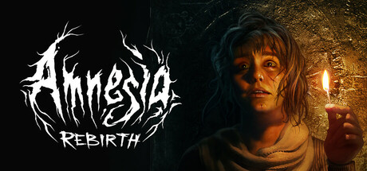

**Amnesia: Rebirth is the terrifying sequel following Tasi Trianon surviving a plane crash in the Algerian desert and uncovering dark truths about herself and an ancient civilization. Features the iconic sanity mechanic and a haunting story about motherhood and loss.**

---

## 📖 About

Amnesia: Rebirth is the terrifying sequel following Tasi Trianon surviving a plane crash in the Algerian desert and uncovering dark truths about herself and an ancient civilization. Features the iconic sanity mechanic and a haunting story about motherhood and loss.

## ⚠️ Problems Without Trainer

| Problem | Status |
|---------|--------|
| **Sanity System** — Looking at monsters or staying in darkness depletes sanity causing hallucinations | ✅ Solved |
| **Darkness Navigation** — Moving through dark areas without matches risks sanity breakdown | ✅ Solved |
| **Puzzle Solutions** — Some environmental puzzles have non-obvious solutions requiring lateral thinking | ✅ Solved |
| **Chase Sequences** — Specific monster pursuit sections have extremely tight hiding window requirements | ✅ Solved |

## ✅ Solution

The **Amnesia: Rebirth Trainer** solves all these issues by giving you complete control over the game.

## 🎯 Full Feature List

- Unlimited Resources
- God Mode / Invincibility
- Instant Skill Cooldown
- One-Hit Kill
- Freeze Game Timer
- Unlock All Items & Achievements
- Custom Speed Multiplier
- Save State Anywhere

## 🚀 Quick Start

1. **Disable Windows Defender** temporarily (trainer may trigger false positive)
2. Download the trainer from the button above
3. Launch Amnesia: Rebirth
4. Run the trainer as Administrator
5. Activate desired cheats with hotkeys

## 💎 Free vs Paid

| Feature | Free | Pro |
|---------|------|-----|
| Basic God Mode | ✅ | ✅ |
| Unlimited Resources | ✅ | ✅ |
| All Advanced Cheats | ❌ | ✅ |
| Auto-Updates | ❌ | ✅ |
| Priority Support | ❌ | ✅ |

## 💻 Requirements

- Windows 10/11 (64-bit)
- Amnesia: Rebirth (any version)
- .NET Framework 4.8+
- DirectX 11+

## 🍎 macOS

macOS users can use our alternative tool:

## ⚖️ Legal

This trainer is for educational and single-player use only. Use responsibly.

---

